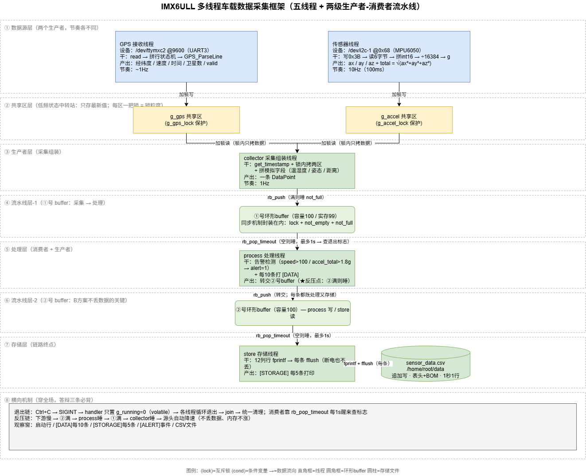

# 车载多线程传感器采集框架（I.MX6U-ALPHA / Linux）

基于 pthread 的多线程数据采集框架：五线程 + **两级生产者-消费者流水线**，采集 GPS / MPU6050 数据，
经组装、告警检测后持久化为 CSV；长跑不掉数据、不涨内存，可被信号干净终止。

> 本工程是《基于嵌入式Linux的车载行车数据记录仪》毕设**上位机（I.MX6ULL）的软件骨架**。

## 架构


- **两条数据源**
  - GPS 线程：`/dev/ttymxc2` @9600，NMEA 拼行状态机 + 解析（~1Hz）
  - 传感器线程：`/dev/i2c-1` 0x68（MPU6050），Linux I2C 文件 IO，100ms 周期
- **共享区**：`g_gps` / `g_accel`，各一把互斥锁；只存"最新值"，锁内只拷数据（锁粒度）
- **两条流水线缓冲**：①号（采集→处理）、②号（处理→存储），带条件变量（满则睡 / 空则睡）
- **三个下游线程**：collector（1Hz 组装 DataPoint）、process（告警检测 + 转交）、store（CSV + 每条 fflush）
- **反压**：下游变慢自动传导到源头（不丢数据、内存不涨）
- **优雅退出**：SIGINT → `volatile g_running` 归零；消费者用 `rb_pop_timeout` 每 1s 醒来看标志，`pthread_join` 收齐后统一清理

## 编译
交叉工具链：gcc-linaro 4.9.4（arm-linux-gnueabihf）

```bash
make            # 产出可执行文件 sensor_framework
make clean
```

## 运行
```bash
scp sensor_framework root@192.168.1.100:/home/root/
ssh root@192.168.1.100 "chmod +x /home/root/sensor_framework && /home/root/sensor_framework"
```
- **前台退出**：`Ctrl+C`（消费者带超时等待，可干净退出）
- **后台运行**：`./sensor_framework > /home/root/run.log 2>&1 & disown`
- **后台停止**：`kill -INT $(pidof sensor_framework)`

## 数据文件
`/home/root/data/sensor_data.csv`（追加写；首行表头，带 UTF-8 BOM 便于 Excel 打开）

- 列顺序（共 12 列）：`时间,纬度,经度,速度,加速度,温度,湿度,俯仰,横滚,距离,valid,告警`
- 稳定 **1 行/秒**；每条 `fflush`（断电不丢已写数据）
- `valid=1` 表示 GPS 已定位（室内通常为 0）

## 目录结构
```
sensor_framework/
├── include/   common.h  ringbuf.h  gps_nmea.h  serial.h  mpu6050_linux.h
├── src/       main.c  ringbuf.c  thread_gps.c  thread_sensor.c  collector.c
│              thread_process.c  thread_store.c  gps_nmea.c  serial.c  mpu6050_linux.c
├── docs/      arch.png（架构图）
└── Makefile
```

## 运行观测（日志）
| 日志 | 含义 | 节奏 |
|---|---|---|
| `[DATA] …` | 处理线程抽样打印（lat/lon/spd/accel/temp/humi/P/R/D/valid） | 每 10 条 |
| `[STORAGE] 已存储 N 条` | 存储进度 | 每 5 条 |
| `[ALERT] [!] …` | 告警事件（超速 >100km/h / 剧烈运动 >1.8g） | 触发式 |

## 验收数据（本阶段实测）
- **加速度**：静止 ≈1.0 g；猛晃峰值 **3.39 g** 触发 `[ALERT] 剧烈运动`
- **稳定性**：连续运行 **3 小时 16 分**（11773 秒），VmRSS **436 → 436 kB 零增长**（无泄漏），无崩溃
- **吞吐 / 零丢失**：11771 条 ÷ 11773 秒 = **1.0000 条/秒**（采集 = 存储 = CSV 行增量）
- **优雅退出**：`Ctrl+C` / `kill -INT` 后五个线程全部打印退出（存储线程报"成功 11771 条，失败 0 条"），程序干净结束

## 已知限制
- GPS 真定位需**窗边/室外**；系统时间依赖板载时钟（无 RTC 后备电池，断电回镜像构建时间）
- 温湿度 / 姿态 / 距离目前为**模拟值**（下位机 STM32 真值后续经 CAN 接入）
- 教学/毕设工程：暂无异常恢复与数据库支持（下一阶段升级 SQLite 存储）
